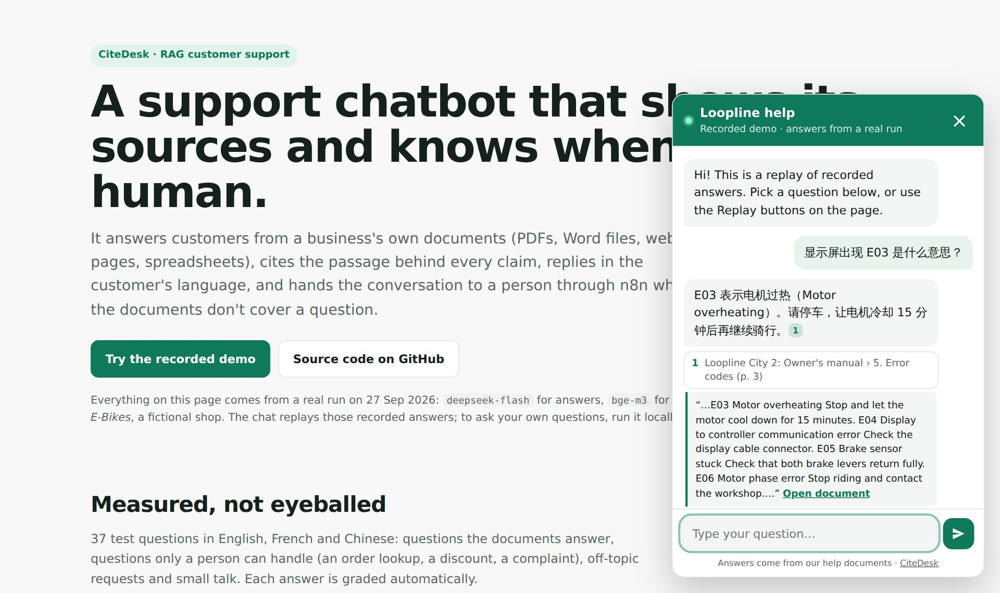
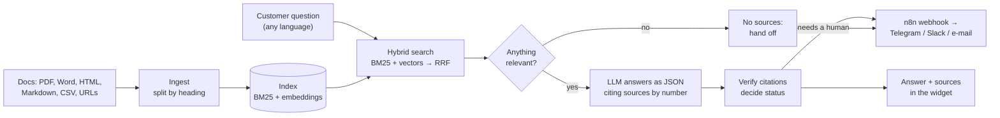
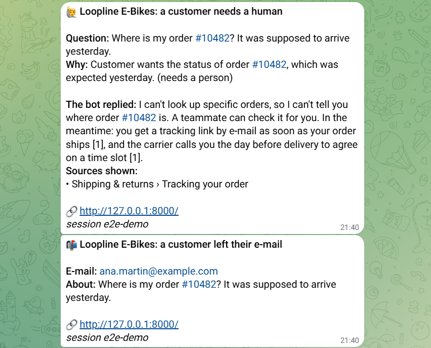

# 💬 CiteDesk

**A customer-support chatbot that answers from your documents, cites every source, and hands the
conversation to a human when it isn't sure.**

Retrieval-augmented generation (RAG) with the guard-rails a real business needs: hybrid search that
works across languages, citations that are checked in code, a relevance gate that stops the model from
improvising, and an n8n handoff so a person picks up what the bot can't answer.

[](https://github.com/yesyesyanyan/citedesk/actions/workflows/ci.yml)
[](https://yesyesyanyan.github.io/citedesk/)


**▶ See it in action:** [yesyesyanyan.github.io/citedesk](https://yesyesyanyan.github.io/citedesk/) replays a real
run: 37 questions in English, French and Chinese, with the answers, their sources and the handoffs, in the actual chat
widget. To ask your own questions, run it locally (a few commands, below).

[](https://yesyesyanyan.github.io/citedesk/)

---

## The problem

Every small business wants an AI assistant on its website, and every owner has the same worry: a bot
that confidently invents a refund policy or a price is worse than no bot at all.

CiteDesk treats the language model as a **fast but fallible writer** and checks its work:

- it only sees passages retrieved from **your** documents, and must cite them by number;
- if nothing relevant is retrieved, it gets **no sources at all** and the question goes to a person;
- citations are **verified in code**: an answer that cites nothing isn't trusted;
- order lookups, discounts, complaints and "can I talk to a human?" are **handed over**, with the
  customer's question, the reason and what the bot said, to your team on Telegram, Slack or e-mail via n8n.

## Features

- **Reads what businesses actually have**: PDF, Word (`.docx`), Markdown, HTML files or live URLs, CSV price lists
- **Cites every claim**: click a source in the chat to see the quoted passage, or open the PDF at the right page
- **Multilingual**: customers ask in French or Chinese about English documents and get answers in their language
- **Hybrid search**: BM25 for exact terms (`E07`, `€149`) + multilingual embeddings for meaning, fused with RRF
- **Knows when to stop**: relevance gate, citation checks and six answer statuses
  (`answered`, `partial`, `not_found`, `handoff`, `off_topic`, `smalltalk`)
- **Human handoff**: the customer can leave an e-mail; n8n alerts the team (Telegram workflow included)
- **One-line website widget**: dependency-free, shadow-DOM isolated, mobile-friendly, light/dark
- **Self-updating**: a nightly n8n workflow re-indexes; unchanged passages keep their embeddings
- **Measured**: `citedesk eval` grades retrieval and answers on a question set, so changes are compared by numbers
- **Provider-agnostic**: Hugging Face, OpenAI, DeepSeek, Groq, OpenRouter… or **fully local with Ollama**
- **Small and readable**: no LangChain, no vector database; about 2,000 lines of Python with 120+ tests

## How it works



## Results

A real run on 27 Sep 2026 with `deepseek-flash` for answers and `bge-m3` (through Ollama) for embeddings, on the
fictional knowledge base in [`samples/loopline`](samples/loopline): six documents in six formats, 38 passages.
Full report: [`evals/results.json`](evals/results.json).

| Questions | | Result |
|---|---|---|
| Answerable from the documents (17 English, 5 French, 4 Chinese) | 26 | **26/26** right facts, cited from the right document, in the customer's language |
| Need a person: order lookup, discount, complaint, "talk to a human", not in the documents | 6 | **6/6** handed over, none bluffed |
| Off-topic: weather, a poem, a prompt-injection attempt | 3 | **3/3** politely declined, nobody alerted |
| Small talk | 2 | **2/2** |

Average answer time 1.2 s; the whole run cost less than one US cent. (The first nine questions were also run with
`google/gemma-4-31B-it` on Hugging Face: all correct, before the free credits ran out.)

**Retrieval**: share of answerable questions whose source document is in the top 6 results:

| | English | French | Chinese |
|---|---|---|---|
| Keyword search (BM25) | 94% | 20% | 25% |
| Embeddings (bge-m3) | 100% | 100% | 100% |
| **Hybrid** | **100%** | **100%** | **100%** |

The documents are in English, so keyword search alone can't serve French or Chinese customers. BM25 stays in the
mix because it is exact where embeddings blur: error codes, prices, product names.

**Relevance gate**: every answerable question scored at least 0.51 cosine similarity with its best passage, every
off-topic or small-talk message at most 0.44, so the default threshold for bge-m3 is 0.45.

A Chinese question answered from the English PDF manual:

> **显示屏出现 E03 是什么意思？** *(What does E03 on the display mean?)*
>
> E03 表示电机过热（Motor overheating）。请停车，让电机冷却 15 分钟后再继续骑行。[1]
>
> [1] Loopline City 2: Owner's manual › 5. Error codes (p. 3)

And one it must not answer on its own:

> **Where is my order #10482? It was supposed to arrive yesterday.**
>
> I can't look up specific orders, so I can't tell you where order #10482 is. A teammate can check it for you. In the
> meantime: you get a tracking link by e-mail as soon as your order ships [1], and the carrier calls you the day before
> delivery to agree on a time slot [1].
>
> → `handoff`: *Customer wants the status of order #10482, which was expected yesterday; needs an order lookup.*

**End to end, with n8n and Telegram**: on 27 Sep 2026 the two workflows ran in n8n 2.35 (Docker). For the
order-status question above, CiteDesk posted a `handoff` event to the `citedesk-handoff` webhook and the team got a
Telegram alert with the question, the reason and the bot's reply; the "leave your e-mail" form produced a second
alert; a normal question produced none. The `citedesk-reindex` workflow called `POST /reindex` and posted its report.

<p align="center"></p>

## Quick start

Requires Python 3.10+.

```bash
git clone https://github.com/yesyesyanyan/citedesk.git
cd citedesk
python -m venv .venv
# Windows: .venv\Scripts\activate    macOS/Linux: source .venv/bin/activate
pip install -e ".[server]"
cp .env.example .env        # Windows: copy .env.example .env
```

Put a Hugging Face token in `.env` (create one at
[huggingface.co/settings/tokens](https://huggingface.co/settings/tokens/new?tokenType=fineGrained) with the
*Make calls to Inference Providers* permission; the free tier is enough to try it). The same token is
used for answers and for embeddings.

```bash
citedesk ingest                 # index the sample knowledge base (samples/loopline)
citedesk serve                  # open http://127.0.0.1:8000 and click the chat button
```

Or stay in the terminal:

```bash
citedesk ask "How long does a full charge take?"
citedesk chat                   # multi-turn, with follow-up questions
citedesk search "E07"           # see what retrieval finds, without calling the LLM
```

## Use it for your own business

```bash
# files, folders and web pages, mixed freely
citedesk ingest docs/ policies/returns.pdf https://www.example.com/faq
```

Set `CITEDESK_SOURCES` and `CITEDESK_COMPANY` in `.env` so the server and the nightly re-index use them.
Re-running `ingest` is incremental: only new or changed passages are embedded again.

### Add the widget to a website

```html
<script src="https://your-citedesk-server/widget.js" defer
        data-title="Ask Loopline"
        data-color="#0f7a5a"
        data-suggestions="How long does delivery take?|Can I return a bike?"></script>
```

Set `CITEDESK_CORS_ORIGINS=https://www.your-site.com` on the server. Other options: `data-greeting`,
`data-subtitle`, `data-open`, `data-endpoint`. The page can also drive it: `CiteDesk.ask("…")`.

### Choosing a model

Everything goes through one OpenAI-compatible client:

| Provider | `CITEDESK_BASE_URL` | Key | Model |
|---|---|---|---|
| Hugging Face (default) | `https://router.huggingface.co/v1` | `HF_TOKEN` | `google/gemma-4-31B-it`, … |
| Ollama (local, private) | `http://localhost:11434/v1` | – | e.g. `qwen3:8b` (+ `CITEDESK_REASONING_EFFORT=none`) |
| OpenAI | `https://api.openai.com/v1` | `CITEDESK_API_KEY` | any chat model |
| DeepSeek / Groq / OpenRouter / vLLM | their OpenAI-compatible URL | `CITEDESK_API_KEY` | any chat model |

Embeddings come from Hugging Face (`BAAI/bge-m3` by default, same token), from any OpenAI-compatible
`/embeddings` endpoint (`CITEDESK_EMBED_BASE_URL`, e.g. Ollama with `bge-m3`), or are switched off
(`CITEDESK_EMBED_BACKEND=none`) for keyword-only search. See [`.env.example`](.env.example) for every setting.

## n8n workflows

Import them from [`n8n/`](n8n) (*Workflows → Import from file*). Tested with n8n 2.35:

| Workflow | What it does |
|---|---|
| [`citedesk-handoff.json`](n8n/citedesk-handoff.json) | Receives handoff and "customer left an e-mail" events from CiteDesk and alerts the team on Telegram |
| [`citedesk-reindex.json`](n8n/citedesk-reindex.json) | Every night calls `POST /reindex` and reports changed documents (or failures) |
| [`citedesk-telegram-bot.json`](n8n/citedesk-telegram-bot.json) | Lets customers chat with CiteDesk on Telegram, with per-chat memory (needs n8n reachable over HTTPS; its Code nodes are unit-tested, the Telegram trigger itself was not run end to end) |

Connect CiteDesk to the handoff workflow with `CITEDESK_HANDOFF_WEBHOOK=<the webhook's production URL>`
and, once n8n is on the internet, a shared `CITEDESK_WEBHOOK_SECRET`. The JavaScript of every Code node
lives in [`n8n/src/`](n8n/src) and is unit-tested; `python scripts/build_workflows.py` rebuilds the JSON.

## HTTP API

`citedesk serve` also serves interactive docs at `/docs`.

| Endpoint | |
|---|---|
| `POST /ask` | `{"question": "...", "session_id": "...", "history": [...]}` → answer, status, `needs_human`, citations |
| `POST /contact` | the customer's e-mail after a handoff; forwarded to the webhook |
| `POST /reindex` | rebuild the index from `CITEDESK_SOURCES` (header `X-API-Key: $CITEDESK_ADMIN_KEY`) |
| `GET /sources` | the indexed documents |
| `GET /health` | status, model, index size |

```bash
curl -s localhost:8000/ask -H "Content-Type: application/json" \
     -d '{"question": "Do you deliver to Switzerland?"}'
```

Questions are rate-limited per visitor (`CITEDESK_RATE_LIMIT`, default 20/min) and logged to
`logs/conversations.jsonl` (set `CITEDESK_LOG_PATH=` to disable).

## Evaluation

[`evals/questions.jsonl`](evals/questions.jsonl) describes what a good answer looks like for each question:

```json
{"id": "return-ridden", "question": "Can I return an e-bike after I've ridden it?", "type": "answerable",
 "sources": ["shipping-and-returns.html"], "facts": ["50", "10%"]}
{"id": "order-status", "question": "Where is my order #10482?", "type": "needs_human"}
```

```bash
citedesk eval --retrieval-only        # free and deterministic: is the right document retrieved?
citedesk eval -o report.json          # full pipeline with the LLM, graded
```

CI runs the test suite and the keyword-only retrieval eval on every push.

The [showcase page](https://yesyesyanyan.github.io/citedesk/) is built from a saved report and replays it in the real
widget, so it can be hosted for free without a server or an API key:

```bash
python scripts/build_showcase.py evals/results.json --recorded "27 Sep 2026"   # -> showcase/
```

Pushing `showcase/` to `main` publishes it to GitHub Pages ([`.github/workflows/pages.yml`](.github/workflows/pages.yml));
`scripts/deploy_showcase.py` publishes the same folder as a static Hugging Face Space instead.

## Design notes

- **No sources, no answer.** Below the similarity threshold the model is told there are no sources, so it
  can only say it doesn't know. Thresholds are calibrated per embedding model (`CITEDESK_MIN_SIMILARITY`).
- **Citations are data, not decoration.** The model returns source numbers as JSON; the code drops numbers
  that don't exist, renumbers the rest in reading order, and escalates "answers" that cite nothing.
- **Language-agnostic keyword search.** Accents are folded and Chinese/Japanese/Korean text is indexed as
  character pairs, so BM25 still works without language-specific tokenizers.
- **Chunks keep their context.** Documents are split by heading and each passage is indexed with its
  document title and section path ("Warranty policy › Motor and battery"), which short passages need.
- **Injection-aware prompt.** Retrieved text is marked as reference material; instructions inside
  documents are ignored.
- **Safe to expose.** Input limits, rate limiting, an admin key for re-indexing, and `/files` only serves
  documents that are part of the index.

## Project layout

```
citedesk/            the package: loaders, chunking, bm25, embeddings, index, answer, server, cli, evaluate
citedesk/static/     widget.js (the chat widget) and the demo page
n8n/                 importable workflows (+ src/ with the Code-node JavaScript)
samples/loopline/    the fictional knowledge base (PDF, DOCX, HTML, Markdown, CSV)
evals/               the question set
scripts/             sample generator, workflow builder, showcase builder/deployer
tests/               120+ tests: Python, the n8n Code nodes (run with Node.js) and the widget
```

## License

MIT. Loopline E-Bikes and all sample documents are fictional.
